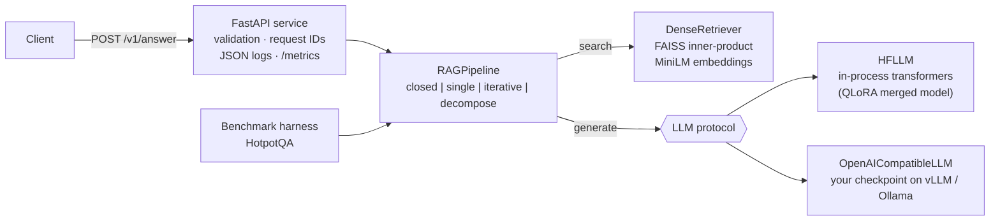
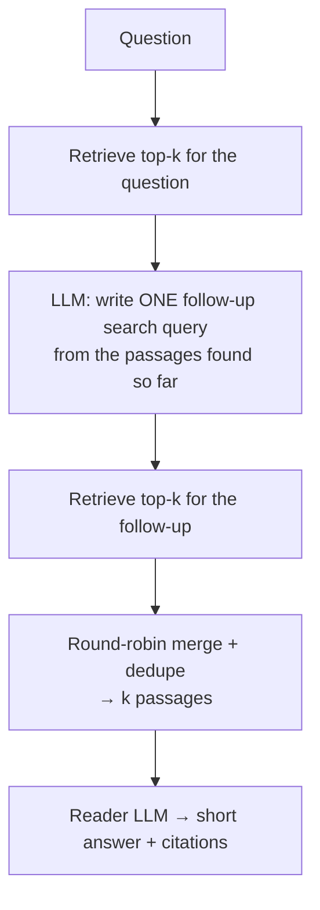

# Multi-Hop RAG with QLoRA Fine-Tuning

[](https://github.com/a1if/qlora-multihop-rag/actions/workflows/ci.yml)
[](https://www.python.org/)
[](LICENSE)

An end-to-end project on **improving a small open LLM (DeepSeek-R1-Distill-Qwen-1.5B) for multi-hop question answering**: QLoRA fine-tuning of the reader model, a multi-hop retrieval pipeline, and a reproducible HotpotQA benchmark that measures how much each change actually helps.

Around the model sits the engineering needed to iterate on it and ship it: a benchmark harness with significance testing, a FastAPI service with Prometheus metrics, and serving of your own checkpoints in-process or through vLLM / Ollama.

---

## Highlights

| Area | What's here |
|---|---|
| **Retrieval strategies** | `closed` (no retrieval), `single`-hop, `iterative` (LLM writes a follow-up search query from what it found), `decompose` (LLM splits the question up front). Every mode gives the reader the **same passage budget k**, so comparisons are fair. |
| **Serving your checkpoints** | Same pipeline runs the base or fine-tuned model in-process (`hf:<path>`) or served by vLLM / Ollama (`openai:<model>@<url>`), so every checkpoint is benchmarked and served identically ([src/llm.py](src/llm.py)) |
| **Serving** | FastAPI `/v1/answer` with request validation, request-ID propagation, structured JSON logs, `/healthz` + `/readyz`, Prometheus `/metrics` with per-stage latency histograms ([src/api.py](src/api.py)) |
| **Evaluation** | HotpotQA distractor dev set with official EM/F1, supporting-paragraph recall@k, bootstrap 95% CIs, paired-bootstrap significance against a reference system, p50/p95 latency and LLM-call cost per question ([src/eval_hotpotqa.py](src/eval_hotpotqa.py)) |
| **Reliability** | Resumable JSONL predictions, concurrent evaluation over HTTP backends, thread-safe per-request timing, retries/timeouts on the HTTP client |
| **Fine-tuning** | QLoRA (4-bit NF4 + LoRA) on DeepSeek-R1-Distill-Qwen-1.5B, merged for serving ([src/finetune.py](src/finetune.py)) |
| **Quality gates** | 57 unit/integration tests running in ~2 s with a fake embedder and scripted LLM (no model downloads), ruff, GitHub Actions on Python 3.10/3.12, Docker build check |

---

## Architecture



### Iterative multi-hop retrieval



---

## Quick start

### Run the stack with Docker (Ollama + API)

```bash
docker compose up -d ollama
docker compose exec ollama ollama pull deepseek-r1:1.5b
docker compose run --rm indexer            # builds ./indexes/hotpotqa
docker compose up -d api
```

```bash
curl -s localhost:8080/v1/answer -H 'content-type: application/json' \
  -d '{"question": "Which country was the discoverer of polonium born in?", "mode": "iterative"}'
```

Response (shape):

```json
{
  "request_id": "6f1c0a9e2b7d4c13",
  "answer": "...",
  "mode": "iterative",
  "queries": ["Which country was ...", "<LLM-written follow-up query>"],
  "passages": [{"title": "...", "text": "...", "score": 0.71}],
  "latency_ms": 0.0,
  "timings": {"retrieval_s": 0.0, "llm_s": 0.0, "llm_calls": 2}
}
```

To serve the fine-tuned checkpoint instead, run it with vLLM (`vllm serve ./new_merged_model_fp32`) and point `QMR_LLM` at it.

### Run locally

```bash
pip install -r requirements-serve.txt        # API + benchmark against an HTTP backend
python -m src.build_index --hotpotqa --n 500
QMR_LLM=openai:deepseek-r1:1.5b@http://localhost:11434/v1 QMR_INDEX_DIR=indexes/hotpotqa \
  uvicorn src.api:app --port 8080
```

| Env var | Default | Meaning |
|---|---|---|
| `QMR_LLM` | `hf:deepseek-ai/DeepSeek-R1-Distill-Qwen-1.5B` | LLM backend spec |
| `QMR_INDEX_DIR` | `indexes/arxiv` | Directory written by `src.build_index` |
| `QMR_PROMPT_STYLE` | `chat` | `chat` (tokenizer template) or `alpaca` (fine-tune format), `hf:` only |
| `QMR_REASONING` | `false` | Allow R1 `<think>` reasoning (stripped from answers) |
| `QMR_TOP_K` / `QMR_HOPS` | `5` / `2` | Default passage budget and hops |

---

## Benchmark: HotpotQA

`src/eval_hotpotqa.py` samples N questions from the HotpotQA distractor dev set with a fixed seed. It pools all their paragraphs (2 gold + 8 distractors each) into one corpus, so the retriever has to find the right 2 among roughly 10×N. It then runs any set of `<model>:<mode>` systems:

```bash
python -m src.eval_hotpotqa --n 500 \
  --model base=openai:base@http://localhost:8000/v1 \
  --model ft=openai:ft@http://localhost:8001/v1 \
  --systems base:closed base:single base:iterative base:decompose ft:single ft:iterative \
  --reference base:single --workers 8
```

Outputs go to `results/hotpotqa/`: per-question predictions (`preds/…/*.jsonl`), the run config (`config.json`), and `summary.md` / `summary.csv` with:

- **EM / F1** (official HotpotQA normalisation) with 95% bootstrap CIs, split by bridge vs comparison questions
- **Support recall@k** and **all-support@k**: did retrieval surface the gold paragraphs?
- **ΔF1 vs reference** with a paired-bootstrap CI (significant if it excludes 0)
- **p50/p95 latency**, **LLM calls per question**, and the share of time spent in the LLM vs retrieval

<!-- Paste results/hotpotqa/summary.md here after a full run. -->

---

## Fine-tuning the reader (QLoRA)

```python
from src.finetune import run_finetuning
from configs.training_config import FinetuneConfig

run_finetuning(FinetuneConfig())   # 4-bit NF4 base + LoRA (r=128, α=64) → merged model
```

The merged model can be loaded in-process (`hf:./new_merged_model_fp32`) or served with vLLM and benchmarked as `ft:*` systems against the base model. Training needs a CUDA GPU; serving and evaluation don't.

---

## Project structure

```
src/
  llm.py            LLM protocol + HF / OpenAI-compatible backends
  retriever.py      FAISS dense retriever, round-robin evidence merge
  rag_pipeline.py   retrieval strategies, prompts, stage timing
  text_utils.py     <think> stripping, answer / query / sub-question parsing
  metrics.py        EM, F1, support recall, bootstrap CIs
  hotpotqa.py       dataset loader + pooled corpus
  eval_hotpotqa.py  ablation benchmark CLI
  api.py            FastAPI service
  app.py            Gradio demo
  build_index.py    index build CLI (arXiv or HotpotQA)
  finetune.py       QLoRA training
tests/              fake embedder + scripted LLM; pipeline, API, harness, backend tests
configs/            dataclass configs
notebooks/          original coursework notebook (superseded by src/)
```

## Development

```bash
pip install -r requirements-dev.txt
ruff check src tests configs
pytest
```

## References

- [QLoRA: Efficient Finetuning of Quantized LLMs](https://arxiv.org/abs/2305.14314), Dettmers et al., 2023
- [HotpotQA: A Dataset for Diverse, Explainable Multi-hop Question Answering](https://arxiv.org/abs/1809.09600), Yang et al., 2018
- [Interleaving Retrieval with Chain-of-Thought Reasoning (IRCoT)](https://arxiv.org/abs/2212.10509), Trivedi et al., 2023
- [Retrieval-Augmented Generation for Knowledge-Intensive NLP Tasks](https://arxiv.org/abs/2005.11401), Lewis et al., 2020

## License

MIT, see [LICENSE](LICENSE).
