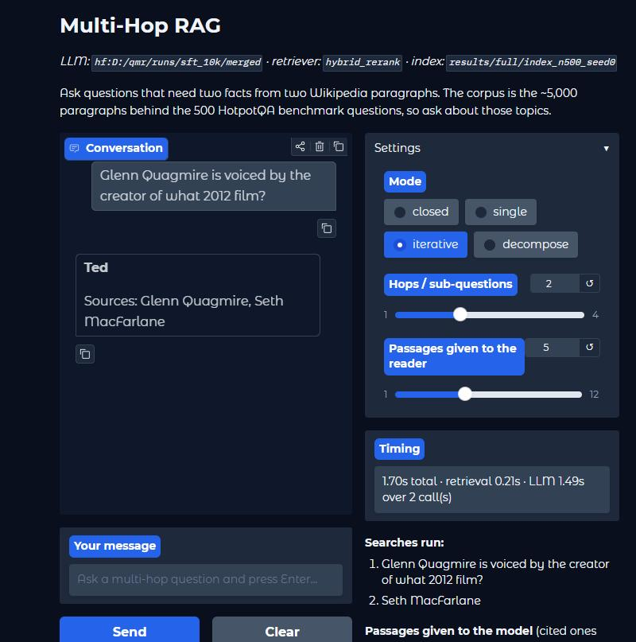
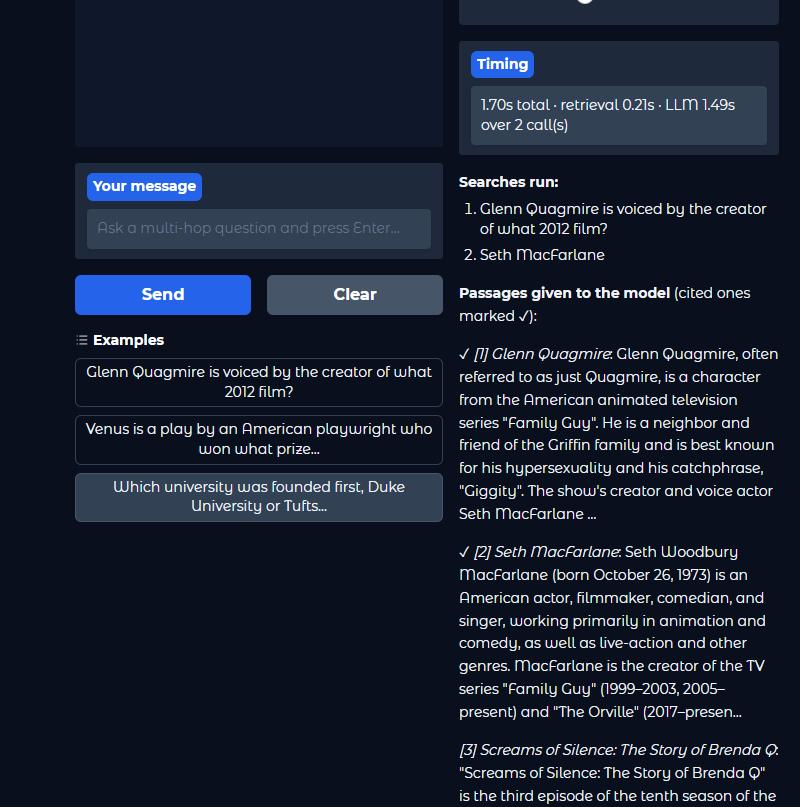
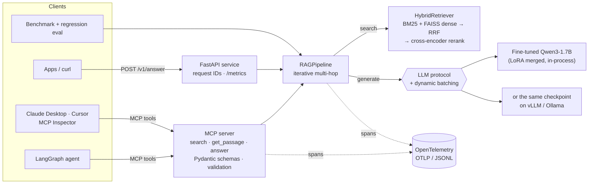
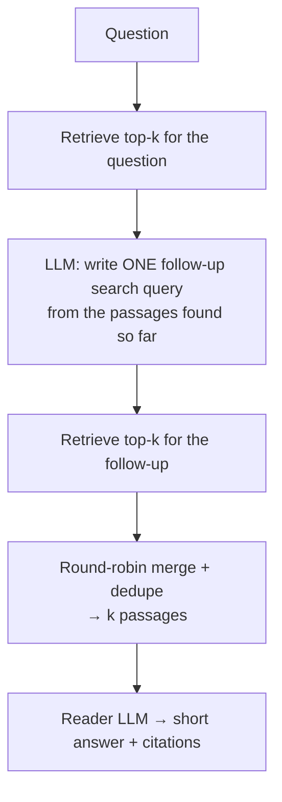

# Multi-Hop RAG with a Fine-Tuned Small LLM

[](https://github.com/a1if/qlora-multihop-rag/actions/workflows/ci.yml)
[](https://www.python.org/)
[](LICENSE)

An end-to-end project on **improving a small open LLM (Qwen3-1.7B) for multi-hop question answering**: LoRA fine-tuning of the reader model, a multi-hop retrieval pipeline, and a reproducible HotpotQA benchmark that measures how much each change actually helps.

Around the model sits the engineering needed to iterate on it and ship it: a benchmark harness with significance testing, an **MCP server** that exposes the pipeline as typed tools for agents, OpenTelemetry tracing, a FastAPI service with Prometheus metrics, and a regression eval that gates CI.

**Headline results** (500 HotpotQA dev questions, one RTX 5070):

| | Result |
|---|---|
| Exact match, base model → final system | **10.4 → 58.4** (F1 13.9 → 71.2) |
| vs a 4.7× larger Qwen3-8B (same pipeline, not fine-tuned) | **matches it** (71.2 vs 69.3 F1, n.s.) at **~8× the throughput** |
| Both supporting passages retrieved | 54% → **89%** |
| LangGraph agent after tool-use fine-tuning | **+19.7 F1** over the base agent |
| Fine-tuning speed / memory | **2.8× faster**, 10.8 → 4.9 GB |

📄 **[Full technical report](REPORT.md)** · 📊 **[Raw result tables](docs/results/)** (regenerate with `python scripts/export_results.py`)

## Demo

The chatbot (`.\scripts\run_chatbot.ps1`, then http://127.0.0.1:7860) answers with the fine-tuned model and shows its work: the searches it ran, every passage it read, and which ones it cited.

| Answer with sources | Search trail and cited evidence (✓) |
|---|---|
|  |  |

*Glenn Quagmire is voiced by the creator of what 2012 film?* → search the question → the model writes the follow-up search **"Seth MacFarlane"** → answers **Ted**, citing both passages (1.7 s).

## Proof

| Claim | Evidence |
|---|---|
| Improvement ladder, every stage | [dense](docs/results/benchmark_1_ladder_dense.md) · [hybrid](docs/results/benchmark_2_hybrid.md) · [hybrid + rerank](docs/results/benchmark_3_hybrid_rerank.md) |
| Fine-tuned 1.7B matches Qwen3-8B | [8B reference run](docs/results/benchmark_6_reference_qwen3_8b_4bit.md) |
| More data didn't help | [30k-example run](docs/results/benchmark_5_sft_full_30k.md) |
| Retriever fine-tuning | [dense](docs/results/benchmark_4_tuned_embedder_dense.md) · [with rerank](docs/results/benchmark_4_tuned_embedder_hybrid_rerank.md) |
| Agent results and ablations | [agents](docs/results/agents.md) |
| Training speed-up and runs | [speed sweep](docs/results/training_speed_sweep.md) · [training runs](docs/results/training_runs.md) |
| Faithfulness / citation gates in CI | [regression eval](docs/results/regression_eval.md) · [recorded outputs](evals/recorded/) |
| MCP server works with a real client | [MCP Inspector session](docs/results/mcp_inspector.md) |

Each table is regenerated from the saved per-question predictions by [`scripts/export_results.py`](scripts/export_results.py).

---

## Highlights

| Area | What's here |
|---|---|
| **Retrieval** | Dense FAISS, BM25 (own inverted index), hybrid via reciprocal rank fusion, cross-encoder reranking; contrastively fine-tuned embedder ([src/retriever.py](src/retriever.py), [src/finetune_retriever.py](src/finetune_retriever.py)) |
| **Multi-hop strategies** | `closed`, `single`-hop, `iterative` (the LLM writes the next search from what it found), `decompose`. Every mode gives the reader the **same passage budget k**, so comparisons are fair. |
| **MCP server** | `search`, `get_passage`, `answer` tools with Pydantic input/output schemas, limits, validation and actionable errors; stdio + streamable HTTP; LLM loads lazily ([src/mcp_server.py](src/mcp_server.py)) |
| **Observability** | OpenTelemetry: a span per MCP request (SDK) with `rag.answer` → `retrieval.search` / `retrieval.rerank` / `llm.generate` children; OTLP, JSONL or console export; one JSON log line per request with trace id ([src/telemetry.py](src/telemetry.py)) |
| **Serving your checkpoints** | Same pipeline runs the base or fine-tuned model in-process (`hf:<path>`) or served by vLLM / Ollama (`openai:<model>@<url>`), so every checkpoint is benchmarked and served identically ([src/llm.py](src/llm.py)) |
| **Serving** | FastAPI `/v1/answer` with request validation, request-ID propagation, structured JSON logs, `/healthz` + `/readyz`, Prometheus `/metrics` with per-stage latency histograms ([src/api.py](src/api.py)) |
| **Evaluation** | HotpotQA distractor dev set with official EM/F1, supporting-paragraph recall@k, bootstrap 95% CIs, paired-bootstrap significance against a reference system, p50/p95 latency and LLM-call cost per question ([src/eval_hotpotqa.py](src/eval_hotpotqa.py)) |
| **Reliability** | Resumable JSONL predictions, concurrent evaluation over HTTP backends, thread-safe per-request timing, retries/timeouts on the HTTP client |
| **Fine-tuning** | LoRA / QLoRA SFT on Qwen3-1.7B for two tasks (grounded reader with citations + abstention, hop-2 query writer); loss on answer tokens only with LM-head logits computed only over the answer span (2.8× faster, half the memory) ([src/finetune.py](src/finetune.py), [src/data_sft.py](src/data_sft.py)) |
| **Speed** | Dynamic batching of concurrent generation calls for evaluation and serving (3.3× faster eval) ([src/batching.py](src/batching.py)) |
| **Quality gates** | 132 tests (fake embedder + scripted LLM, real MCP client in-process), a 25-question regression eval with retrieval hit-rate and faithfulness gates, ruff, GitHub Actions on Python 3.10/3.12, Docker build check |

---

## Architecture



### Iterative multi-hop retrieval



---

## Quick start

### Run the stack with Docker (Ollama + API)

```bash
docker compose up -d ollama
docker compose exec ollama ollama pull qwen3:1.7b
docker compose run --rm indexer            # builds ./indexes/hotpotqa
docker compose up -d api mcp                 # REST on :8080, MCP on :8765/mcp
```

```bash
curl -s localhost:8080/v1/answer -H 'content-type: application/json' \
  -d '{"question": "Which country was the discoverer of polonium born in?", "mode": "iterative"}'
```

Response (shape):

```json
{
  "request_id": "6f1c0a9e2b7d4c13",
  "answer": "...",
  "mode": "iterative",
  "queries": ["Which country was ...", "<LLM-written follow-up query>"],
  "passages": [{"title": "...", "text": "...", "score": 0.71}],
  "latency_ms": 0.0,
  "timings": {"retrieval_s": 0.0, "llm_s": 0.0, "llm_calls": 2}
}
```

To serve the fine-tuned checkpoint instead, run it with vLLM (`vllm serve <run_dir>/merged`) and point `QMR_LLM` at it.

### Use it from an MCP client

The server speaks stdio (desktop clients) and streamable HTTP. Search tools only need the index; the LLM loads on the first `answer` call.

```bash
# Interactive: MCP Inspector (opens a local web UI)
npx @modelcontextprotocol/inspector python -m src.mcp_server

# Remote clients / agents
python -m src.mcp_server --transport streamable-http      # http://127.0.0.1:8765/mcp
```

Claude Desktop (`claude_desktop_config.json`):

```json
{
  "mcpServers": {
    "multihop-rag": {
      "command": "D:\\qmr\\venv\\Scripts\\python.exe",
      "args": ["-m", "src.mcp_server"],
      "cwd": "C:\\path\\to\\qlora-multihop-rag",
      "env": {"QMR_LLM": "hf:D:/qmr/runs/sft_full/merged", "QMR_INDEX_DIR": "indexes/hotpotqa",
              "QMR_RETRIEVER": "hybrid_rerank", "HF_HOME": "D:/qmr/hf-cache"}
    }
  }
}
```

| Tool | Input | Output |
|---|---|---|
| `search` | `query` (1–500 chars), `k` (1–20, default 5) | `{query, results: [{id, title, text, score}]}` |
| `get_passage` | `passage_id` | `{id, title, text, formatted}`; unknown ids get an error naming the valid range |
| `answer` | `question`, `mode` (`iterative` default) | `{answer, queries, passages, citations, latency_s}` |

### GPU environment (training and local inference)

```powershell
.\scripts\setup_gpu_env.ps1 -EnvRoot D:\qmr   # venv + Hugging Face cache (~15 GB), PyTorch for CUDA 12.8
$env:HF_HOME = "D:\qmr\hf-cache"; & D:\qmr\venv\Scripts\Activate.ps1
```

### Run locally

```bash
pip install -r requirements-serve.txt        # API + benchmark against an HTTP backend
python -m src.build_index --hotpotqa --n 500
QMR_LLM=openai:qwen3:1.7b@http://localhost:11434/v1 QMR_INDEX_DIR=indexes/hotpotqa \
  uvicorn src.api:app --port 8080
```

| Env var | Default | Meaning |
|---|---|---|
| `QMR_LLM` | `hf:Qwen/Qwen3-1.7B` | LLM backend spec |
| `QMR_INDEX_DIR` | `indexes/arxiv` | Directory written by `src.build_index` |
| `QMR_PROMPT_STYLE` | `chat` | `chat` (tokenizer template) or `alpaca` (fine-tune format), `hf:` only |
| `QMR_REASONING` | `false` | Allow `<think>` reasoning (stripped from answers) |
| `QMR_TOP_K` / `QMR_HOPS` | `5` / `2` | Default passage budget and hops |
| `QMR_RETRIEVER` | `dense` | `dense`, `hybrid` (BM25 + dense, RRF) or `hybrid_rerank` |
| `QMR_EMBEDDING_MODEL` | `all-MiniLM-L6-v2` | Embedding model name or path (e.g. the fine-tuned retriever) |
| `OTEL_EXPORTER_OTLP_ENDPOINT` | unset | Send traces to an OTLP collector (Jaeger, Tempo, Langfuse, ...) |
| `QMR_TRACE_FILE` / `QMR_TRACE_CONSOLE` | unset | Write spans to a JSONL file / stderr |

---

## Improvement ladder

One model, Qwen3-1.7B, improved one technique at a time. Every stage is measured on the same 500 HotpotQA dev questions.

| Stage | Adds | Technique |
|---|---|---|
| 0 | Baseline | Closed-book: the model answers from its own weights |
| 1 | RAG | Single-hop dense retrieval (FAISS + MiniLM) |
| 2 | Multi-hop RAG | Iterative retrieval: the model writes a follow-up search query from what it found |
| 3 | Better retrieval | Hybrid BM25 + dense search, cross-encoder reranking |
| 4 | Retriever fine-tuning | Contrastive tuning of the embedding model on question → supporting passages |
| 5 | LLM fine-tuning | LoRA SFT (bf16), one adapter for three tasks: grounded reader with citations, abstention when evidence is missing, and the hop-2 query writer |

### Results

Qwen3-1.7B · 500 HotpotQA dev questions (distractor set, 4,943 pooled paragraphs) · 5 passages per answer · greedy decoding.

| Stage | EM | F1 (95% CI) | Both gold passages retrieved |
|---|---|---|---|
| 0 · model alone | 10.4 | 13.9 [11.2, 16.8] | – |
| 1 · + RAG (single dense search) | 34.0 | 43.2 [39.1, 47.4] | 54.4% |
| 2 · + iterative multi-hop retrieval | 37.2 | 47.8 [43.6, 52.0] | 59.8% |
| 3 · + hybrid BM25 + dense, cross-encoder rerank | 43.6 | 54.4 [50.4, 58.5] | 75.8% |
| 5 · + LoRA fine-tuned LLM (10k examples) | **58.4** | **71.2 [67.8, 74.7]** | **89.0%** |

Each row adds one technique to the row above (rows 2–5 use iterative multi-hop retrieval).

- **Fine-tuning** adds +16.8 F1 on top of the best base pipeline. The fine-tuned hop-2 query writer is a large part of it: with dense retrieval alone, both supporting passages are found 74.8% of the time vs 59.8% for the base model.
- **Trained abstention:** when retrieval misses evidence (dense, multi-hop), wrong answers drop from 83% to 29%; only 1.4% of questions are refused despite full evidence. Citation precision 91%, recall 97%.
- **Hybrid retrieval and reranking stack with fine-tuning:** fine-tuned multi-hop goes 62.1 → 64.8 (hybrid) → 71.2 F1 (+ reranker).
- **Retriever fine-tuning (Stage 4)** takes 107 s and lifts single-hop dense retrieval from 54.4% to 70.8% both-gold recall (EM 34.0 → 39.2), close to hybrid + reranker. Combined with the reranker it adds nothing (71.0 vs 71.2 F1), because both fix the same misses, so the tuned embedder is the cheaper alternative when a reranker isn't affordable.
- Splitting the question up front (decomposition) gave no gain (+0.6 F1, n.s.), so iterative retrieval is the multi-hop strategy.
- **More data didn't help:** training on all 29.7k examples (1 h 45 min) instead of 10k (34 min) lowered validation loss (0.234 → 0.201) but not benchmark accuracy (−1.1 F1, 95% CI [−3.7, +1.6]), so the 10k model is the final one.

### Why not just use a bigger model?

The same pipeline (hybrid retrieval + rerank, iterative multi-hop), the same 500 questions, with a 4.7× larger model that is not fine-tuned:

| Model | EM | F1 (95% CI) | Throughput (RTX 5070) |
|---|---|---|---|
| Qwen3-8B, base, 4-bit | 56.8 | 69.3 [65.9, 72.8] | 0.31 questions/s |
| **Qwen3-1.7B, LoRA fine-tuned** | **58.4** | **71.2 [67.8, 74.7]** | **2.61 questions/s** |

The fine-tuned 1.7B model **matches the 8B model** (paired difference +1.6 EM [−2.4, +5.8], +2.0 F1 [−1.5, +5.4], not significant) **at ~8× the throughput** and a fraction of the memory. (The 8B model runs in 4-bit to fit in 12 GB, which may cost it a little accuracy.)

### Agent: fine-tuning for tool use

A LangGraph ReAct agent drives the MCP tools itself (it decides what and how often to search). Same retrieval, the first 100 benchmark questions:

| Approach | EM | F1 | Both gold passages seen | Searches / question |
|---|---|---|---|---|
| Base Qwen3-1.7B agent | 36 | 44.4 | 53% | 1.09 |
| Base agent, thinking mode | 29 | 33.7 | 30% | 0.83 |
| **Tool-use fine-tuned agent** (LoRA, 7,040 trace steps, 57 min) | **55** | **64.1** | **93%** | **1.97** |
| Fine-tuned fixed 2-hop pipeline (reference) | 58 | 69.0 | 84% | 2.00 |

- Left to plan, the 1.7B model searched once and stopped on 89/100 questions; thinking mode was worse (it skipped search on 48/100) and 20× slower.
- Fine-tuning on HotpotQA tool-use traces (search the question → search the bridge entity → answer, plus early-stop and abstain variants, rendered byte-identically to the live agent) fixed it: **+19.7 F1** (95% CI [+8.3, +30.8]), two searches on 97/100 questions, and the highest evidence recall of any setup.
- It is statistically level with the fixed pipeline (−4.9 F1, CI [−14.0, +4.2]); it over-abstains (17% vs 5%).
- The pipeline-tuned model stopped calling tools entirely: narrow fine-tuning overrides general behaviour, so tool use needed its own training data.
- **Ablation, fewer abstain traces (10% → 3%):** the agent stopped refusing but never stopped searching. It searched its own answer entity in a loop until the step limit on all 100 questions (0 EM) and ignored in-context guardrail messages. Tool-layer guardrails (repeated-search block, search budget) plus a forced final answer with the reply prefilled as `Answer:` recovered it to 38 EM / 47.6 F1, still well below the 10% version (−16.5 F1, CI [−25.9, −6.9]). The abstain traces were also the model's only learned way to stop, so the 10% model stays the final agent; the guardrails stay as a safety net.

### Training and inference efficiency (RTX 5070, 12 GB)

| | Before | After | |
|---|---|---|---|
| Fine-tuning throughput | 857 tok/s | 2,418 tok/s | **2.8×**: LM head computed only over the answer span (`logits_to_keep`), loss/gradients verified identical |
| Fine-tuning peak memory (batch 4) | 10.8 GB | 4.9 GB | batch 8 went from OOM to 6.0 GB |
| Evaluation, multi-hop, 500 questions | 11 min 23 s | 3 min 27 s | **3.3×**: dynamic batching of concurrent generate calls, 95% identical answers |

A 10k-example LoRA run takes 34 minutes.

## Benchmark: HotpotQA

`src/eval_hotpotqa.py` samples N questions from the HotpotQA distractor dev set with a fixed seed. It pools all their paragraphs (2 gold + 8 distractors each) into one corpus, so the retriever has to find the right 2 among roughly 10×N. It then runs any set of `<model>:<mode>` systems:

```bash
python -m src.eval_hotpotqa --n 500 \
  --model base=openai:base@http://localhost:8000/v1 \
  --model ft=openai:ft@http://localhost:8001/v1 \
  --systems base:closed base:single base:iterative base:decompose ft:single ft:iterative \
  --reference base:single --workers 8
```

Outputs go to `results/hotpotqa/`: per-question predictions (`preds/…/*.jsonl`), the run config (`config.json`), and `summary.md` / `summary.csv` with:

- **EM / F1** (official HotpotQA normalisation) with 95% bootstrap CIs, split by bridge vs comparison questions
- **Support recall@k** and **all-support@k**: did retrieval surface the gold paragraphs?
- **ΔF1 vs reference** with a paired-bootstrap CI (significant if it excludes 0)
- **p50/p95 latency**, **LLM calls per question**, and the share of time spent in the LLM vs retrieval

<!-- Paste results/hotpotqa/summary.md here after a full run. -->

---

## Regression eval (CI)

A 25-question slice of the benchmark lives in [evals/](evals/) (questions, their 250 paragraphs, gates in `thresholds.json`) and runs in GitHub Actions:

- **Retrieval hit rate**, live: BM25 over the eval corpus must keep both gold paragraphs in the top 5 for ≥ 64% of questions and at least one for ≥ 92%.
- **Answer quality on recorded outputs**: the real fine-tuned pipeline is recorded once through the MCP `answer` tool (`python -m evals.record`); CI gates EM, faithfulness (every answer word must appear in a passage it cites), citation precision, and whether abstentions happen only when evidence is missing.
- `QMR_LIVE_EVAL=1 pytest tests/test_evals.py` re-runs the same checks against the live model on a GPU.

## Observability

```bash
QMR_TRACE_FILE=traces.jsonl python -m src.mcp_server --transport streamable-http
python -m src.telemetry traces.jsonl        # per-span count, errors, p50 / p95 latency
```

One `answer` call produces a single trace: `tools/call answer` → `rag.answer` → `retrieval.search` ×2 (→ `retrieval.rerank`) and `llm.generate` ×2, with attributes such as the query, k, result count, model and token budget. Point `OTEL_EXPORTER_OTLP_ENDPOINT` at Jaeger or Langfuse for a UI.

## Fine-tuning

```bash
python -m src.data_sft --n 20000 --out data/sft          # reader + abstain + query-writer examples
python -m src.finetune --set run_name=sft_full            # LoRA, bf16, answer-span loss → adapter + merged model
python -m src.finetune_retriever --n 20000                # contrastive embedder tuning (~2 min)
python scripts/speed_sweep.py                             # throughput per training setting
```

The merged model is benchmarked as `ft:*` systems (`--model ft=hf:<run_dir>/merged`). Training needs a CUDA GPU; serving and evaluation don't.

---

## Project structure

```
src/
  llm.py            LLM protocol + HF / OpenAI-compatible backends, shared prompt rendering
  batching.py       dynamic batching of concurrent generate() calls
  retriever.py      dense FAISS, BM25, RRF hybrid, cross-encoder rerank, round-robin merge
  rag_pipeline.py   retrieval strategies, prompts, stage timing, tracing spans
  mcp_server.py     MCP server: search / get_passage / answer tools
  telemetry.py      OpenTelemetry setup, spans, trace summary CLI
  data_sft.py       SFT data builder (reader, abstain, query writer)
  data_agent.py     tool-use traces for the agent, rendered exactly as the live agent sees them
  agent.py          LangGraph ReAct agent over the MCP tools, local tool-calling chat model, guardrails
  finetune_retriever.py  contrastive embedder fine-tuning
  text_utils.py     <think> stripping, answer / query / sub-question parsing
  metrics.py        EM, F1, support recall, bootstrap CIs
  hotpotqa.py       dataset loader + pooled corpus
  eval_hotpotqa.py  ablation benchmark CLI
  api.py            FastAPI service
  app.py            Gradio demo
  build_index.py    index build CLI (arXiv or HotpotQA)
  finetune.py       LoRA / QLoRA SFT with answer-span loss
evals/              25-question regression set, checks, recorder, CI gates
scripts/           GPU env setup, chatbot launcher, training speed sweep, result export, resharder
docs/results/       result tables regenerated from saved predictions (proof for every README number)
docs/images/        chatbot screenshots
REPORT.md           full technical report
tests/              fake embedder + scripted LLM; pipeline, MCP, tracing, eval, training tests
configs/            dataclass configs
notebooks/          original coursework notebook (superseded by src/)
```

## Development

```bash
pip install -r requirements-dev.txt
ruff check src tests configs evals scripts
pytest
```

## References

- [QLoRA: Efficient Finetuning of Quantized LLMs](https://arxiv.org/abs/2305.14314), Dettmers et al., 2023
- [HotpotQA: A Dataset for Diverse, Explainable Multi-hop Question Answering](https://arxiv.org/abs/1809.09600), Yang et al., 2018
- [Interleaving Retrieval with Chain-of-Thought Reasoning (IRCoT)](https://arxiv.org/abs/2212.10509), Trivedi et al., 2023
- [Retrieval-Augmented Generation for Knowledge-Intensive NLP Tasks](https://arxiv.org/abs/2005.11401), Lewis et al., 2020

## License

MIT, see [LICENSE](LICENSE).
